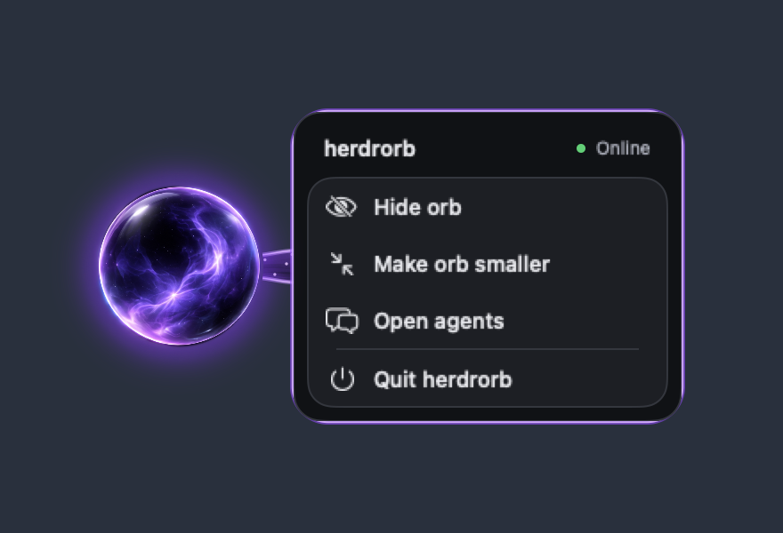
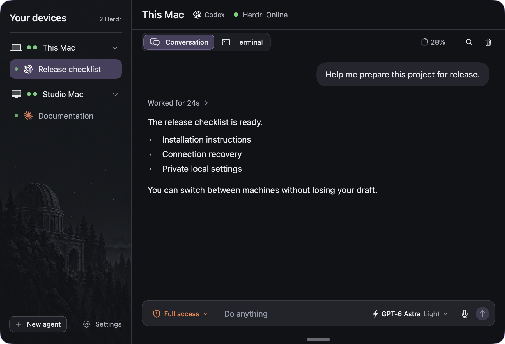
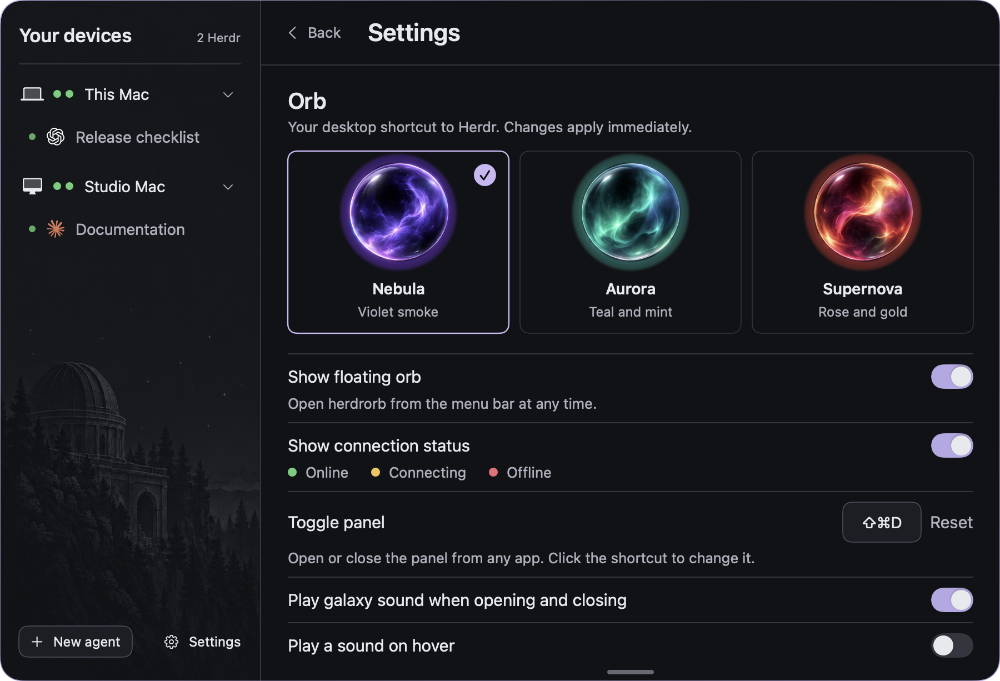
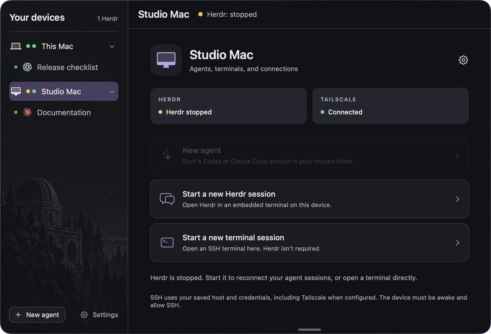
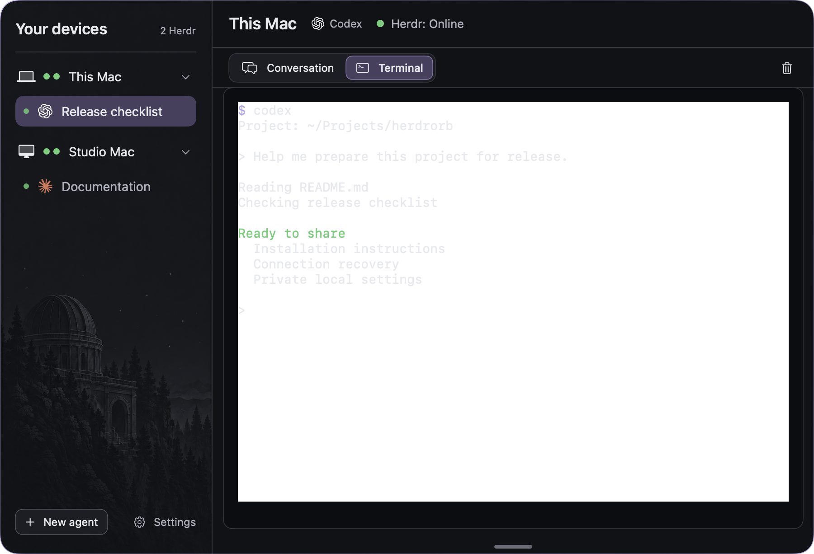

<div align="center">

# herdrorb

**Your coding agents, one glowing orb away.**

A native macOS companion for [Herdr](https://github.com/herdrdev/herdr).
Bring your Codex and Claude Code sessions together across your Macs,
with a floating galaxy orb and a conversation panel that stays close at hand.

[Get started](#get-started) · [Features](#features) · [Screenshots](#screenshots) · [Releases](https://github.com/andrewjedi/herdrorb/releases)



*Click to open. Drag to move. Press ⌘⇧D from anywhere.*

</div>

## A little space for your work

Read a reply, pick up a draft, or check another machine without hunting through
terminal windows. herdrorb keeps your sessions in one sidebar and gives you a
formatted conversation view alongside the live terminal.



*All screenshots are rendered from the current app using fictional demo sessions.*

## Features

| | What you can do |
| --- | --- |
| **A living galaxy orb** | Choose Nebula, Aurora, or Supernova. Move it around your desktop, switch to a smaller size, or hide it and use the menu bar. The panel unfurls with flowing galaxy light and an optional sound. Reduce Motion uses a short fade. |
| **Codex + Claude Code** | Keep both agents in one place. Start an agent in a project folder on your chosen device, then switch sessions while keeping each draft and reading position. |
| **Readable conversations** | Read formatted replies, highlighted code, tables, and collapsible commands and file changes from either agent. Browse and search saved history, and open long replies in a formatted reader. |
| **The live terminal, a click away** | Use inline controls for recognized permission requests and a command palette, with Terminal available for other menus and sign-in. Agent permissions remain with the underlying CLI. |
| **Controls in the composer** | Choose permissions, model, reasoning effort, and Fast mode where supported. Changes become active after the connected CLI confirms them. Dictate into your draft and review before sending. |
| **Devices at a glance** | See Herdr and Tailscale status independently, inspect connection details, and manage executable paths and project defaults per device. |
| **Direct device terminals** | Open a local shell or SSH terminal from the sidebar, even when Herdr is stopped. You can also launch Herdr in its own embedded terminal. |
| **Images and artifacts** | Preview saved images and supported files from agent replies. Codex image generation uses the connected CLI’s native image tool when available. |

## Screenshots

### Pick your galaxy

**Nebula** brings violet smoke, **Aurora** adds teal and mint, and **Supernova**
mixes rose and gold. Appearance, connection status, keyboard shortcuts, and sound
controls live together in Settings.



### Know which device is ready

Open a device overview to check its connections, start an agent, launch Herdr,
or open a terminal directly. Separate Herdr and Tailscale indicators help explain
why a machine is reachable even when its agent server is stopped.



### Go straight to the terminal

Switch from the formatted conversation to the agent’s terminal for approvals,
slash commands, and interactive prompts. For a separate shell, open a direct
local or SSH terminal from the device overview.



## Get started

### Requirements

- **macOS 14 or later**, on Apple Silicon (`arm64`) or Intel (`x86_64`).
- **Herdr 0.9.1, protocol 22**, installed and running on each target Mac.
- **Codex and/or Claude Code**, installed and authenticated on the Macs where they run.
- For remote Macs, a saved Herdr machine profile and working noninteractive SSH.
- To build from source, Xcode or its command-line tools with **Swift 6.0 or newer**.

See the [compatibility and validation table](docs/COMPATIBILITY.md) for tested toolchains.

### Build and open

```sh
git clone https://github.com/andrewjedi/herdrorb.git
cd herdrorb
sh build-app.sh
open dist/herdrorb.app
```

The build resolves pinned Swift Package Manager dependencies, bundles resources
and license notices, and applies a local ad-hoc signature. No Apple developer
account is needed. It does not install or start Herdr or any agent.

[Release archives](https://github.com/andrewjedi/herdrorb/releases) are also available
for each architecture. The developer beta is **ad-hoc signed, not Developer ID
signed or notarized**, so macOS may block downloaded archives. Building from
source is the recommended installation path until a notarized release is available.
Do not disable Gatekeeper system-wide.

### Connect your sessions

1. [Install Herdr](https://github.com/herdrdev/herdr#install) at the compatible version above, then run `herdr` in Terminal.
2. Open herdrorb. Setup checks for a missing installation, stopped server, or unsupported protocol. Use **Locate Herdr…** for a custom executable or **Check again** after starting Herdr.
3. Choose **Continue**, then select an existing session or **New agent**. Agent accounts and sign-in are managed by their CLIs.
4. Click the orb or press **⌘⇧D** to open the panel. Change the shortcut in **Settings → Orb → Toggle panel**.

The menu-bar icon remains available when the orb is hidden. Closing the panel
or quitting herdrorb leaves your Herdr agent sessions running. Direct embedded
shells are separate and close when you quit the app.

### Try it without Herdr

```sh
open -n dist/herdrorb.app --args --demo
```

Demo mode uses fictional in-memory sessions and separate preferences. It never
discovers your machines, connects over SSH, or starts agent processes. Real
session creation and terminal attachment are unavailable. Add `--setup-preview`
to preview the missing-Herdr setup screen.

<details>
<summary><strong>Everyday controls and session behavior</strong></summary>

- **Return** sends; **Shift-Return** inserts a newline. Drafts and reading positions stay with each session.
- Click a **device name** for its overview; click its **chevron** to expand sessions. The paired dots show Herdr on the left and Tailscale on the right. Tailscale presence refreshes every 30 seconds while the panel is open; unknown hosts are not treated as offline.
- Change model and permission settings while the agent is idle. Available choices come from its CLI. Codex Ultra is a reasoning effort, separate from Fast speed; Claude has its own effort levels and permission modes. Claude bypass permissions must be enabled when the session starts. Account or organization restrictions can make Fast unavailable.
- Click the **microphone** to dictate, stop, and review before sending. macOS requests Microphone and Speech Recognition permission on first use. Dictation stops when the panel closes or you switch conversations.
- Type **/** to open the command palette. Model and permissions open native controls; other commands open Terminal. Recognized permission requests can be answered in Conversation; unfamiliar menus remain in Terminal.
- Click a saved image for a large preview, **Full Screen**, or **Open in Preview**; Escape or Space closes the preview. Native image generation must be available in the connected Codex CLI; herdrorb adds no separate API key or paid fallback.
- Open a device’s **gear** for diagnostics, a custom Herdr path, agent executable checks, and project defaults. If agent startup fails, inspect its existing terminal before explicitly retrying.
- **Delete session** asks for confirmation before closing the actual terminal and command. Close direct terminal sessions explicitly to end their shells.

</details>

## Your data and your sessions

herdrorb has **no analytics uploader or account service**. Agent CLIs and Herdr
have their own network behavior. Conversation text and drafts save locally by
default, with private file permissions and bounded retention, without
application-level encryption. Automatic image loading, including over SSH, and
local conversation saving can be controlled in Settings.

Connected sessions read complete messages from saved provider transcripts.
**Connect history** links an existing session; Claude also connects context
telemetry while preserving your existing status line. The context meter uses
provider data and shows an unavailable state when no valid reading exists.
Long conversations use 40-message pages, with search across the archive.

Terminal-only conversation reconstruction is approximate. The live terminal
remains the authoritative interactive view, and herdrorb does not reproduce
Codex desktop’s edit/Undo cards. Uncertain prompt sends are never automatically
retried. Copied diagnostics omit names, paths, SSH targets, conversation text,
and raw error messages.

Read [conversation reliability](docs/CONVERSATION-RELIABILITY.md) and
[privacy and uninstall](docs/PRIVACY.md) for details.

## Contribute and get help

```sh
swift test
sh scripts/check.sh
```

[Contributing](CONTRIBUTING.md) · [Architecture](docs/ARCHITECTURE.md) ·
[Troubleshooting](docs/TROUBLESHOOTING.md) · [Roadmap](ROADMAP.md) ·
[Changelog](CHANGELOG.md)

Report bugs through [Issues](https://github.com/andrewjedi/herdrorb/issues).
Report vulnerabilities privately as described in [SECURITY.md](SECURITY.md).

## License and affiliation

[MIT](LICENSE), copyright © 2026 Andrew Thompson. Bundled dependency notices
are in [THIRD_PARTY_NOTICES.md](THIRD_PARTY_NOTICES.md). Herdr remains a
separately installed project under its own license.

Independent community project. Not affiliated with or endorsed by Herdr,
OpenAI, or Anthropic.
